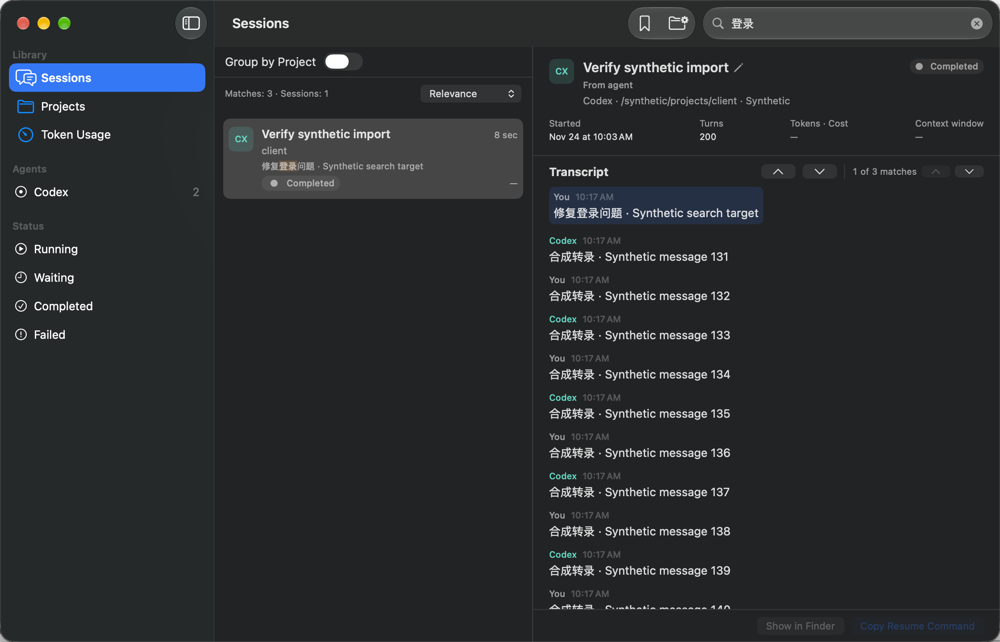
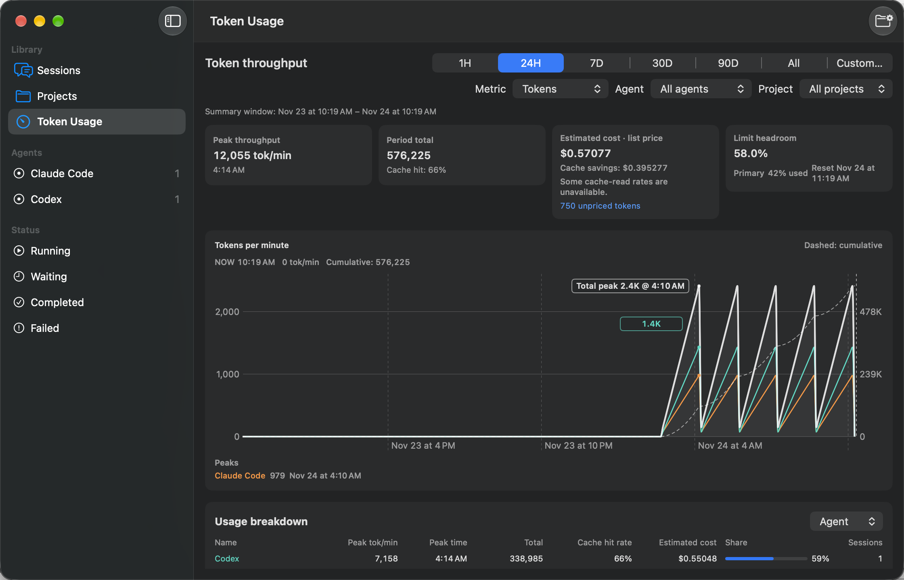
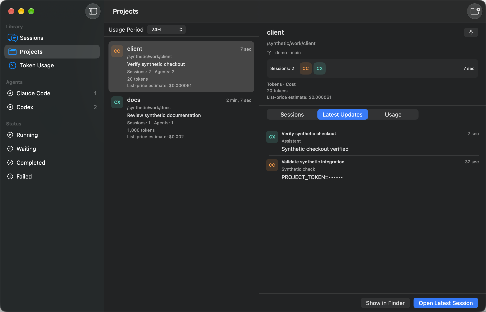

# Agent Dashboard

[简体中文](README.md) · [Download](https://github.com/cchen7/local-agent-dashboard/releases/latest)

All your local Claude Code, Codex and GitHub Copilot CLI sessions in one Mac app. Find last week's error discussion in seconds, catch up on a project's recent work, and see how many tokens each agent used and roughly what they cost.

## Features

- **Search every session.** Full-text search in English and Chinese opens the matching message; step through hits with `⌘G`. Narrow results with filters like `agent:codex in:7d "migration"`, and save frequent queries as Smart Groups.
- **Follow each project.** Sessions, topics and recent progress, grouped by workspace.
- **Token usage and cost.** Usage and throughput per agent, from the last hour to all time. Totals include cache reads and writes, and costs are estimated from public API prices. Also available from the menu bar.
- **Stays on your Mac.** No network access and no AI models. Sessions are read, never modified, and common secrets are masked on screen by default.

  
  

## Install

Requires an Apple silicon Mac with macOS 27 or later.

1. Download the DMG from [Releases](https://github.com/cchen7/local-agent-dashboard/releases/latest) and drag AgentDashboard to Applications. The app is notarized by Apple.
2. On first launch, choose the agents to index and click **Start Indexing**. If your sessions are stored elsewhere, add the folder in **Settings → Sources**.

[MIT License](LICENSE) · [Third-party notices](App/Resources/THIRD-PARTY-NOTICES.txt) · [Developer guide](AGENTS.md)
