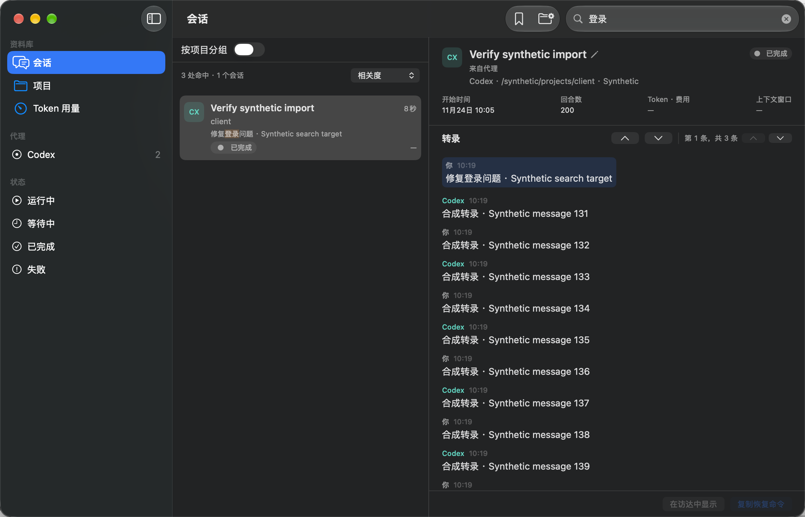
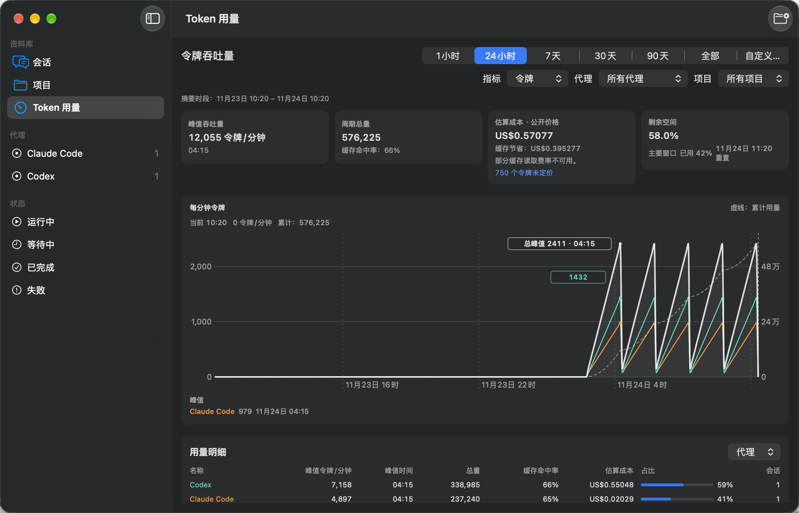
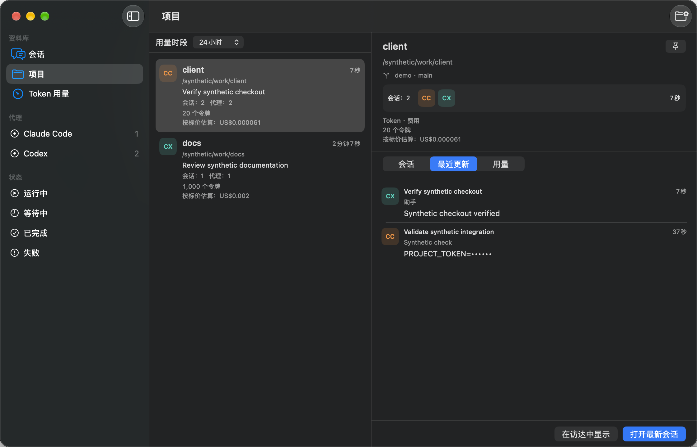

# Agent Dashboard

[English](README.en.md) · [下载](https://github.com/cchen7/local-agent-dashboard/releases/latest)

把 Claude Code、Codex 和 GitHub Copilot CLI 的本地会话收进一个 Mac 应用。用中文或英文搜到上周讨论过的那个报错，按项目回顾最近的进展，看清每个助手用了多少 Token、大约花了多少钱。

## 功能

- **搜索全部会话**：中英文全文搜索，结果直接定位到原始消息，`⌘G` 在命中之间切换。可以用 `agent:codex in:7d "migration"` 这样的条件缩小范围，常用查询能存成智能分组。
- **按项目回顾**：按工作目录汇总会话、主题和最近进展。
- **Token 用量和费用**：从最近 1 小时到全部历史，查看各助手的用量和吞吐。合计包含缓存读写，费用按公开 API 价格估算。菜单栏里也能随时查看。
- **只在本机运行**：不联网，不调用任何模型。只读取会话记录，从不改动；界面默认遮盖常见的密钥和令牌。

  
  

## 安装

需要 Apple silicon 芯片和 macOS 27 或更高版本。

1. 从 [Releases](https://github.com/cchen7/local-agent-dashboard/releases/latest) 下载 DMG，把 AgentDashboard 拖进「应用程序」。应用已通过 Apple 公证。
2. 首次启动时选择要索引的助手，点「开始索引」。会话存放在其他位置的话，到「设置 → 来源」添加目录。

[MIT 许可](LICENSE) · [第三方许可](App/Resources/THIRD-PARTY-NOTICES.txt) · [开发说明](AGENTS.md)
